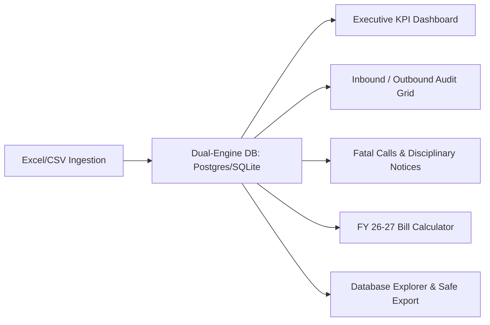

<div align="center">

# ⚡ Maharashtra State Electricity Distribution Co. Ltd. (MSEDCL)
### Enterprise Quality Audit & Performance Analytics Management Portal
**Executive Briefing, Project Architecture & Stakeholder Q&A Guide**

[](https://python.org)
[](https://flask.palletsprojects.com/)
[](https://postgresql.org)
[](https://sqlite.org)
[]()
[]()

<br/>

**A mission-critical Quality Assurance, Contact Center Analytics, Disciplinary Warning/PIP Governance, and Multi-department Audit portal engineered for MSEDCL.**

---

</div>

## 📑 Table of Contents
1. [🏢 Executive Summary: What Problem Does This Solve?](#-executive-summary-what-problem-does-this-solve)
2. [💡 Key Business Benefits for Leadership & Owners](#-key-business-benefits-for-leadership--owners)
3. [🎯 Core System Capabilities](#-core-system-capabilities)
4. [🗣️ Owner & Stakeholder Q&A (How to Answer Common Questions)](#️-owner--stakeholder-qa-how-to-answer-common-questions)
5. [👥 Role-Based Access Control (RBAC) & Privacy](#-role-based-access-control-rbac--privacy)
6. [🏗️ Technical Architecture & Dual-Database Engine](#️-technical-architecture--dual-database-engine)
7. [🛡️ Enterprise Security, Auditability & Compliance](#️-enterprise-security-auditability--compliance)
8. [🚀 Quick Start & Installation](#-quick-start--installation)
9. [🧪 System Verification & Automated Tests](#-system-verification--automated-tests)
10. [📚 Documentation & Resource Index](#-documentation-index)

---

## 🏢 Executive Summary: What Problem Does This Solve?

**Maharashtra State Electricity Distribution Co. Ltd. (MSEDCL / Mahavitaran)** manages millions of consumer interactions across Inbound contact centers (billing queries, outage complaints, meter technical faults) and Outbound operations (bill payment reminders, feedback checks).

### The Challenge Before This Portal:
- QA evaluations were trapped in disconnected, messy Excel files (`.xlsx`).
- Repeat mistakes and critical call failures (Fatal Errors) were difficult to track across hundreds of agents.
- Warning letters and Performance Improvement Plans (PIPs) required manual paperwork, causing delays and compliance disputes.
- Front-line advisors could accidentally view confidential consumer details, posing data privacy risks.

### The Solution:
This portal unifies all call center QA operations into a single, high-performance web platform. It automates **call auditing**, **fatal error alerts**, **5-tier disciplinary & appreciation notices**, **audio playback**, and **official electricity tariff calculations**, giving leadership 100% transparency into contact center performance.

---

## 💡 Key Business Benefits for Leadership & Owners

| Business Need | How This Portal Delivers |
| :--- | :--- |
| **Instant Executive Oversight** | Live executive dashboard with call volume charts, QA score band trends, fatal error breakdowns, and department scorecards. |
| **Data Integrity & De-duplication** | Every uploaded audit file is verified with SHA-256 fingerprinting to eliminate duplicate evaluations and inaccurate billing reports. |
| **Standardized Disciplinary Action** | One-click generation of 5-Tier Notices (Warning 1, Warning 2, Final Warning, 30-Day PIP, and Appreciation Letters) with pre-filled call evidence. |
| **Customer Data Protection** | Strict Role-Based Access Control (RBAC) masks customer phone numbers, meter numbers, and private notes from front-line agents. |
| **Zero Vendor Lock-in / Low TCO** | Runs on modern open-source foundations (Python Flask + PostgreSQL / SQLite), deployable on-premise, inside government cloud (MeghRaj), or standard private cloud. |

---

## 🎯 Core System Capabilities



1. **Live High-Density Audits View (`/audits/Inbound`, `/audits/Outbound`)**:
   - 8-column high-density table displaying Agent Name, Employee ID, Score, Call Duration, Audio Link, and Category.
   - Built-in color grading: **Green (≥90%)**, **Blue (80-89%)**, **Amber (<80%)**, and **Solid Red Badge** for Fatal infractions.
   - Inline audio player allows managers and auditors to listen to recordings instantly without downloading external files.

2. **Automated 5-Tier Notice & PIP Engine (`/warnings`)**:
   - Automatically inspects the agent’s audit history:
     - **Tier 1**: First Warning Letter (First low score <80%).
     - **Tier 2**: Second Warning Letter (Repeated low scores).
     - **Tier 3**: Final Warning Letter (Pre-HR escalation).
     - **Tier 4**: Performance Improvement Plan (30-day target timeline with 85% benchmark).
     - **Tier 5**: Appreciation Letter (Recognizing scores ≥90%).
   - Auto-fills call evidence, date, auditor name, and coaching comments into official formal notice templates.

3. **Official FY 2026–27 Mahavitaran Tariff Calculator (`/calculator`)**:
   - Supports **Residential LT I(B)**, **Commercial LT II**, and **Industrial LT V**.
   - Accurately computes energy slabs, Fuel Adjustment Charges (FAC), TOD rates, electricity duty, and sales tax.
   - Instant "Print Sheet" and "Reset Form" buttons for customer service support.

4. **Admin Database Explorer & Secure Export Hub (`/admin/database-explorer`, `/export-center`)**:
   - Live database table viewer with row counts and schema inspector.
   - Full protection against **Spreadsheet Formula Injection (CWE-1236)** (sanitizes `=`, `+`, `-`, `@`).
   - Passwords and confidential credentials automatically masked as `[REDACTED]`.

---

## 🗣️ Owner & Stakeholder Q&A (How to Answer Common Questions)

When demonstrating this project to owners, directors, or technical evaluators, use the exact answers below:

### 1. "What is the exact purpose of this project?"
> *"It is an automated quality assurance and compliance portal for MSEDCL call centers. It replaces manual spreadsheets with real-time audit dashboards, tracks agent call quality scores, flags fatal errors immediately, and automates official disciplinary warnings and PIPs."*

### 2. "How does the system ensure data security and customer privacy?"
> *"The system uses strict Role-Based Access Control (RBAC). Front-line advisors only have access to their own scorecards and cannot see other agents' evaluations. Furthermore, customer PII (phone numbers, account numbers, and sensitive notes) is automatically masked for advisors. Sensitive database fields like passwords use scrypt cryptographic hashing and are redacted from database exports."*

### 3. "What happens if our PostgreSQL database goes offline?"
> *"The backend includes a resilient dual-engine connection pool ([database.py](file:///database.py)). In production, it connects to PostgreSQL with connection pooling. If PostgreSQL is temporarily unavailable or during local offline maintenance, it smoothly falls back to the embedded SQLite database (`quality_audit.db`) so operations never halt."*

### 4. "How do auditors upload call evaluation data?"
> *"Auditors navigate to the `/upload` portal and upload their standard `.xlsx`, `.xlsm`, or `.csv` files. The system automatically standardizes column headers, runs SHA-256 de-duplication to prevent double-counting, and immediately updates company-wide KPIs."*

### 5. "How does the system help agents improve their performance?"
> *"Advisors can log in to their personal portal to review their scores, listen to recorded calls, and review specific coaching notes provided by QA auditors. If their score drops below target, the system generates targeted action plans with clear 30-day improvement milestones."*

### 6. "Can we export reports for management reviews?"
> *"Yes. The Export Center (`/export-center`) allows managers to download filtered reports in CSV and Excel formats. All exports are hardened against formula injection (CWE-1236) to ensure files cannot compromise management workstations."*

### 7. "Is this application ready for production cloud deployment?"
> *"Yes. The application is container-ready, includes configuration files for cloud services like Render, AWS RDS, Docker, and Linux Gunicorn servers, and features live `/healthz` endpoints for automated uptime monitoring."*

---

## 👥 Role-Based Access Control (RBAC) & Privacy

The system enforces strict server-side authorization:

| Feature / URL Endpoint | Admin (`admin`) | Quality Auditor (`quality`) | Call Center Manager (`manager`) | Advisor / Viewer (`advisor`, `viewer`) |
| :--- | :---: | :---: | :---: | :---: |
| **Executive Dashboard** (`/`) | Full Call Center Metrics | QA Benchmarks & Trends | Operations & SLA KPI | Strictly Own Performance Metrics |
| **Inbound Audits** (`/audits/Inbound`) | All Audits + Observation Text | All Audits + Observation Text | All Audits + Observation Text | Own Calls Only (Customer Data Masked) |
| **Outbound Audits** (`/audits/Outbound`) | All Audits + Observation Text | All Audits + Observation Text | All Audits + Observation Text | Own Calls Only (Customer Data Masked) |
| **Fatal Infractions** (`/fatal-calls`) | Full Fatal Logs & Root Cause | Full Fatal Logs & Root Cause | Full Fatal Logs & Root Cause | Own Fatal Notices Only |
| **Score Reports** (`/score-reports`) | Company-wide Score Bands | Company-wide Score Bands | Company-wide Score Bands | Own Quality Score Progress |
| **Advisor 360 Search** (`/advisor-search`) | Full Lookup & Telemetry | Full Lookup & Telemetry | Full Lookup & Telemetry | Blocked (Restricted to Own Profile) |
| **Warnings & Notice Dispatch** (`/warnings`) | Create, Send & Close Notices | Create & Review Notices | Create, Review & Close | View Own Notice & Submit Action Plan |
| **Bill Calculator** (`/calculator`) | Allowed | Allowed | Allowed | Allowed (Open to All Staff) |
| **Import Files / Upload** (`/upload`) | Allowed | Allowed | Allowed | Blocked |
| **Export Center** (`/export-center`) | Unrestricted CSV & Excel | Department Exports | Department Exports | Own Records Export |
| **Database Explorer** (`/admin/database-explorer`) | Live SQL/Table Explorer | Blocked (403) | Blocked (403) | Blocked (403) |
| **User Management** (`/admin/users`) | Add/Edit/Reset Users | Blocked (403) | View/Manage Staff | Blocked (403) |

---

## 🏗️ Technical Architecture & Dual-Database Engine

```text
MSEDCL_Quality_Audit_System/
├── app.py                      # Core Flask Application & API Routes
├── database.py                 # Dual-Engine Connection Pool (PostgreSQL / SQLite)
├── db_explorer_service.py      # Admin Database Explorer Backend
├── export_service.py           # Formula-Injection-Safe CSV/Excel Exporter
├── init_db.py                  # Database Schema Initializer & Demo Seeder
├── migrate_sqlite_to_postgres.py # Automated Migration Tool with Reconciliation Report
├── test_system.py              # Automated Unit Test Suite
├── quality_audit.db            # Local SQLite Database (Fallback)
├── templates/                  # Jinja2 HTML5 Templates
│   ├── dashboard.html          # Executive & Advisor KPI Dashboard
│   ├── audits_view.html        # Compact 8-Column Audits Data Grid
│   ├── warnings.html           # 5-Tier Formal Notices & Smart Auto-Fill
│   ├── calculator.html         # FY 26-27 Mahavitaran Electricity Bill Calculator
│   └── db_explorer.html        # Admin Database Explorer UI
├── static/                     # CSS Design System & Chart.js Visualizations
└── docs/                       # Technical & Architectural Documentation
```

### Dual-Engine Database Layer ([database.py](file:///database.py))
- **Production Connection Pooling**: Uses `psycopg2.pool.ThreadedConnectionPool` with statement timeouts and auto-reconnect.
- **Dynamic SQL Query Normalization**: Transparently converts placeholders (`?` vs `%s`) and date functions (`datetime('now')` vs `NOW()`).
- **Resilient Fallback**: If PostgreSQL credentials are not provided or if the network drops, it immediately defaults to the local SQLite database.

---

## 🛡️ Enterprise Security, Auditability & Compliance

1. **Password Security**: Passwords are saved with salted `scrypt` hashing via Werkzeug security primitives.
2. **Formula Injection Sanitization (CWE-1236)**: User input beginning with `=`, `+`, `-`, or `@` is prepended with single quotes (`'`) before generating spreadsheets.
3. **HTTP Hardening**: Standard security response headers are enforced (`X-Content-Type-Options: nosniff`, `X-Frame-Options: SAMEORIGIN`, `X-XSS-Protection`).
4. **Audit Logging**: All database administration, user logins, and exports are recorded with user IDs and timestamps.

---

## 🚀 Quick Start & Installation

### 1. Set Up Environment
```bash
# Clone the repository
git clone https://github.com/WeWake2026/MSEDCL.git
cd MSEDCL

# Create virtual environment
python -m venv .venv

# Activate on Windows:
.\.venv\Scripts\activate
# Activate on Linux/Mac:
source .venv/bin/activate

# Install required dependencies
pip install -r requirements.txt
```

### 2. Configure Environment Variables
Copy `.env.example` to `.env`:
```bash
cp .env.example .env
```
*(Optional: Configure `DATABASE_URL` for PostgreSQL; if left blank, system automatically uses local SQLite).*

### 3. Initialize Database & Seed Baseline Data
```bash
# Using virtual environment Python:
.\.venv\Scripts\python.exe init_db.py

# Or standard Python / py launcher:
py init_db.py
# (or 'python init_db.py' if in PATH)
```

### 4. Start the Application
```bash
# Windows Quick Launcher (PowerShell / Command Prompt):
.\run.bat

# Or Direct Virtual Environment Python:
.\.venv\Scripts\python.exe app.py

# Or Windows Python Launcher:
py app.py
```
Visit **`http://localhost:5000`** in your browser.

**Default Login Credentials:**
- **Admin**: `qaadmin` / `Msedcl@123`
- **Quality Auditor**: `auditor1` / `Audit@123`
- **Manager**: `manager1` / `Manager@123`
- **Advisor**: `adv101` / `Advisor@123`

---

## 🧪 System Verification & Automated Tests

Verify system health, security headers, role restrictions, and database adapters by running:
```bash
# Using virtual environment Python:
.\.venv\Scripts\python.exe test_system.py

# Or standard Python / py launcher:
py test_system.py
```
**Automated test coverage includes:**
- `/healthz` API endpoint and latency check.
- HTTP security header verification.
- Advisor data isolation and PII protection tests.
- Database explorer access controls & password redaction verification.
- Spreadsheet export formula injection neutralization (CWE-1236).

---

## 📚 Documentation Index

For in-depth guides, see the [docs/](file:///docs) directory:
- [SETUP_GUIDE.md](file:///docs/SETUP_GUIDE.md) — Step-by-step setup guide with exact Windows CMD commands.
- [DATABASE_GUIDE.md](file:///docs/DATABASE_GUIDE.md) — Schema definitions, table relationships, and role least-privilege matrix.
- [MIGRATION_GUIDE.md](file:///docs/MIGRATION_GUIDE.md) — SQLite to PostgreSQL migration, verification, and rollback manual.
- [SECURITY_AUDIT.md](file:///docs/SECURITY_AUDIT.md) — Security audit findings, threat modeling, and vulnerability remediation.
- [MSEDCL_PROJECT_GUIDE.md](file:///docs/MSEDCL_PROJECT_GUIDE.md) — Strategic roadmap and deep-dive architecture specification.
- [MOBILE_BUGS_AUDIT.md](file:///docs/MOBILE_BUGS_AUDIT.md) — Responsive design analysis and UI audit.
