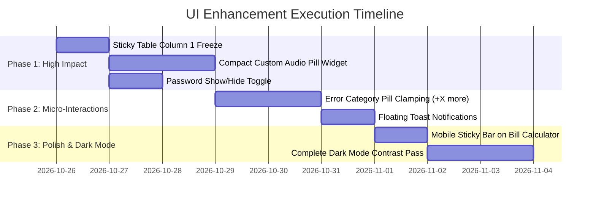

# 🎨 MSEDCL Call Center QA System — Comprehensive UI/UX Audit & Improvement Plan

---

## 1. Executive UI Evaluation

The MSEDCL Quality Audit System features an enterprise layout inspired by official Maharashtra State electricity portals (deep navy `#0d3b66` to `#1d63b8` sidebar, clean white card modules, and high-density data tables).

Following a systematic screen-by-screen audit across desktop, laptop, and tablet viewports, this document outlines:
1. **Current UI strengths and design patterns**.
2. **Page-by-page visual discrepancies and usability friction**.
3. **High-priority UI/UX improvements with exact implementation recommendations**.

---

## 2. Page-by-Page UI Audit Matrix

| Page / Template | Current Visual Status | Identified UI Friction & Issues | Recommended UI Enhancement |
| :--- | :---: | :--- | :--- |
| **Top Navigation & Sidebar** (`layout.html`) | Clean Navy Theme | Notification bell shows a static `3` badge regardless of actual alert count; sidebar logo text wraps awkwardly on screens $\le 1280\text{px}$. | Dynamic unread badge counter, collapsible icon-only sidebar mode with smooth CSS transition, and unified breadcrumb trail. |
| **Executive Dashboard** (`dashboard.html`) | Dense 5-Card Metric Row | 5 KPI cards in Row 1 can cause horizontal scroll or cramped wrapping on $1366\times768$ laptop screens. Chart.js canvases lack skeleton loader states while data loads. | Use CSS CSS Grid `minmax(200px, 1fr)` with responsive auto-fit; add subtle hover micro-elevation (`transform: translateY(-2px)`) and canvas shimmer loaders. |
| **Audited Interactions Grid** (`audits_view.html`) | 8-Column Compact Table | 1. Audio player element (`<audio>`) is styled with native browser chrome, taking up uneven widths across Chrome/Edge/Firefox.<br>2. Filter form submit causes full page reload losing table scroll position. | 1. Replace with custom mini-pill audio widget with SVG play/pause icon, duration timestamp, and stream link.<br>2. Implement asynchronous debounced search/filter without full page refresh. |
| **Advisor 360 Search** (`advisor_search.html`) | Telemetry Cards & Timeline | Observation modal expansion has fixed height that can overflow mobile screens. Error categories pills can create jagged row heights when an audit has 6+ categories. | Clamped tag carousel (shows first 2 categories with `+X more` popover) to keep grid rows strictly uniform. |
| **Warnings & PIP Register** (`warnings.html`) | Form + Accordion Register | Email body `<textarea>` takes 8 static rows, pushing the Action button off the primary viewport. Notice status pills lack distinct icons. | Auto-expanding textarea based on content length; distinct color/icon badges (`Draft 📝`, `Sent ✉️`, `Closed ✅`). |
| **Mahavitaran Bill Calculator** (`calculator.html`) | Multi-Tariff FY 26-27 | Forms look clean with 0-state inputs, but on mobile devices the two final bill cards (`CURRENT BILL` & `TOTAL PAYABLE BILL`) stack with large vertical gaps. | Add a sticky bottom floating summary bar on mobile showing the net payable amount in INR (`₹`) as inputs change. |
| **Export Center** (`export_center.html`) | Card Matrix | "Download All Reports ZIP" button in amber can visually clash with the green Excel button. | Unified export action bar with clean file-type icons (.xlsx, .csv, .zip) and file size estimate indicator. |
| **Admin Database Explorer** (`db_explorer.html`) | Dark/Light Dual Mode | Very wide tables with 20+ columns force broad horizontal scrollbars without sticky primary key (`id` / `call_id`) column freezing. | Sticky freeze for Column 1 (`ID`) during horizontal table scroll, preventing users from losing context. |
| **Login Screen** (`login.html`) | Centered Gradient Card | Standard password input lacks a 1-click **"Show / Hide Password"** toggle button. | Add interactive eye icon toggle to reveal/hide password characters before submit. |

---

## 3. Top 5 High-Impact UI Improvements (Detailed Specs)

### Improvement 1: Modern Custom Audio Player Widget for Call Records
* **Current Problem**: The browser's native `<audio controls>` renders inconsistently across browsers (Safari, Chrome, Firefox) and consumes between $110\text{px}$ to $220\text{px}$ of column width.
* **Proposed Design**:
  ```html
  <!-- Ultra-Compact Enterprise Audio Pill -->
  <div class="audio-pill-widget">
    <button class="audio-play-btn" onclick="toggleAudio(this, 'audio-id')">
      <span class="icon">▶</span>
    </button>
    <div class="audio-track-progress">
      <span class="time-current">00:00</span>
      <div class="progress-bar"><div class="progress-fill" style="width: 35%;"></div></div>
      <span class="time-total">02:45</span>
    </div>
    <a href="{{ url }}" target="_blank" class="audio-stream-link" title="Open Stream">🔗</a>
  </div>
  ```
* **Visual Result**: Reduces column width to a neat $140\text{px}$, maintains uniform table rows, and prevents layout shifts.

---

### Improvement 2: Sticky Freeze for First Column in Wide Tables
* **Current Problem**: In [`templates/audits_view.html`](file:///c:/Users/Vivek/Downloads/MSEDCL_Quality_Audit_System_Starter/MSEDCL_Quality_Audit_System/templates/audits_view.html) and [`templates/db_explorer.html`](file:///c:/Users/Vivek/Downloads/MSEDCL_Quality_Audit_System_Starter/MSEDCL_Quality_Audit_System/templates/db_explorer.html), scrolling right to view audio links or observations loses track of which Call ID or Advisor the row belongs to.
* **Proposed CSS Fix**:
  ```css
  /* Sticky Column 1 in Horizontal Scroll Grids */
  .data-table th:first-child,
  .data-table td:first-child {
    position: sticky;
    left: 0;
    z-index: 2;
    background: var(--bg-card);
    box-shadow: 2px 0 4px rgba(0, 0, 0, 0.05);
  }
  .data-table th:first-child {
    z-index: 12; /* Stays above row cells during scroll */
    background: var(--bg-card-subtle);
  }
  ```

---

### Improvement 3: Dynamic Clamping for Multiple Error Category Pills
* **Current Problem**: Some calls have 5 to 8 error categories concatenated with semicolons (e.g., `Advisor should complete probing; Avoid dead air; Need to follow hold procedure; Advisor should active; Accurate tagging`). This causes single table rows to double or triple in height.
* **Proposed Fix**:
  * Display the first **2 badges**.
  * Collapse remaining into a `+3 more` badge that displays the full list on hover/click popover.
  * Ensures every table row stays strictly **$42\text{px}$ in height** (dense data grid).

---

### Improvement 4: Smart Interactive Toast Notifications
* **Current Problem**: Flask flash messages (`flash("Batch imported", "success")`) render as static banner alerts at the top of the content container, pushing dashboard KPIs down.
* **Proposed Enhancement**:
  * Render alerts as auto-dismissing **floating toast cards** in the bottom-right corner (fading out smoothly after 4 seconds).
  * Keeps the primary dashboard KPIs and filters at the top without vertical jarring.

---

### Improvement 5: Password Visibility Toggle on Sign-In Page
* **Current Problem**: On [`templates/login.html`](file:///c:/Users/Vivek/Downloads/MSEDCL_Quality_Audit_System_Starter/MSEDCL_Quality_Audit_System/templates/login.html) and [`templates/user_management.html`](file:///c:/Users/Vivek/Downloads/MSEDCL_Quality_Audit_System_Starter/MSEDCL_Quality_Audit_System/templates/user_management.html), administrators and advisors cannot verify what they typed into the password field before submitting.
* **Proposed Fix**: Add a subtle SVG eye button inside the password input container that switches `type="password"` to `type="text"` on click.

---

## 4. Typography, Palette & Spacing Standards

| Element | Current Value | Standardized Recommendation |
| :--- | :--- | :--- |
| **Base Font Family** | `Inter, sans-serif` | Maintain `Inter, -apple-system, BlinkMacSystemFont, 'Segoe UI', Roboto, sans-serif` (Optimal clarity). |
| **Body Background (Light)** | `#f0f4f8` / `#f8fafc` | Standardize to **`#f8fafc` (Slate 50)** for modern enterprise feel. |
| **Body Background (Dark)** | `#0b1120` | Standardize to **`#0f172a` (Slate 900)**. |
| **Primary Brand Navy** | `#0d3b66` | `#0d3b66` (Header brand) & `#1d63b8` (Interactive brand blue). |
| **Card Borders** | `1px solid #e2e8f0` | `1px solid #e2e8f0` with `border-radius: 8px`. |
| **Table Header Text** | Uppercase `11px`, bold `600` | Uppercase `11px`, letter-spacing `0.5px`, color `#64748b`. |

---

## 5. Implementation Roadmap (Phased Execution)


