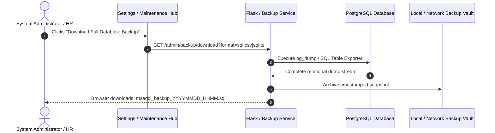
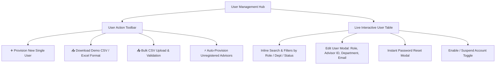
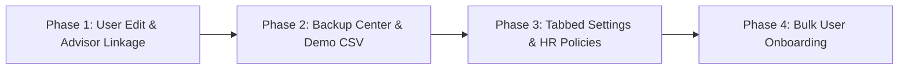

# MSEDCL Quality Audit System: Enterprise HR & Organization Settings & User Provisioning Architecture Plan

## 1. Executive Summary & Enterprise Requirements Analysis
Based on deep operational analysis of **MSEDCL (Maharashtra State Electricity Distribution Co. Ltd.)** contact center operations, managing over 1,000+ customer support advisors, quality evaluators, HR personnel, and operational managers across multiple zones/circles (Inbound, Outbound, Billing, Technical, Power Outage / Outage Helpline 1912) requires an enterprise-grade administration architecture.

This expanded master plan specifies:
1. **Full Company & HR Operational Settings Analysis**: What HR, Quality, and Operations leadership actually need configured at the enterprise level (escalation chains, PIP periods, disciplinary tiers, work shifts, training triggers, auto-notifications).
2. **Comprehensive Multi-Format Database Backup & Restore Engine**: Automated scheduled backups, instant PostgreSQL SQL/CSV dump downloads, cloud cold-storage retention, and safe restoration mechanisms.
3. **User Creation Demo Formats & Bulk Onboarding Templates**: Exact CSV, Excel, and JSON templates for onboarding advisors, team leaders, auditors, managers, and HR business partners, including sample data matching MSEDCL employee structures.
4. **Interactive User Profile Management**: Full editing capabilities, password generation, credential delivery, and status governance.

---

## 2. Enterprise HR & Organizational Settings Analysis

```mermaid
flowchart TD
    subgraph EnterpriseSettings["MSEDCL Enterprise System & HR Settings Architecture"]
        HR["👥 HR & Disciplinary Governance"]
        ORG["🏢 Organizational Structure & Circles"]
        QA["🎯 Quality & Coaching Rules"]
        NOTIF["📢 Communication & Escalations"]
        SEC["🔒 Security, Compliance & Shifts"]
        BACKUP["💾 Disaster Recovery & Backups"]
    end

    HR --> H1["PIP Duration (30/45/60 Days)"]
    HR --> H2["Warning Escalation Hierarchy"]
    HR --> H3["Mandatory Coaching Thresholds"]

    ORG --> O1["Circle / Zone / Call Center Setup"]
    ORG --> O2["Vendor / BPO Management"]
    ORG --> O3["Language & Skill Queue Mapping"]

    QA --> Q1["Fatal Error Zero-Tolerance Rules"]
    QA --> Q2["Target Score Benchmarks (Default: 85%)"]
    QA --> Q3["Auditor Calibration Variance Allowance"]

    NOTIF --> N1["HR Business Partner CC Recipient"]
    NOTIF --> N2["SMTP / O365 Graph Dispatcher"]
    NOTIF --> N3["Automated Weekly Performance Digest"]

    BACKUP --> B1["Instant SQL & CSV Full Export"]
    BACKUP --> B2["Nightly Automated Snapshot Cron"]
    BACKUP --> B3["Retention & Storage Management"]
```



### 2.1. HR & Disciplinary Policy Settings (New)
At MSEDCL, call quality is tied directly to customer satisfaction and state regulatory (MERC) compliance. HR requires clear system policies:
- **Warning & Disciplinary Escalation Policy**:
  - `First Warning Threshold`: Triggered after $N$ fatal calls (default: `1`) or $X$ consecutive weeks under 80% (default: `2 weeks`).
  - `Second Warning Escalation`: Triggered if score does not recover within 14 calendar days.
  - `PIP (Performance Improvement Plan) Policy`: Standard duration configurable (e.g., `15 Days`, `30 Days`, `45 Days`) with mandatory weekly milestone reviews.
  - `HR Business Partner Email Routing`: Central HR email (e.g. `hr.bpo@msedcl.in`) automatically CC'd on all generated Warning/PIP formal communication.
- **Mandatory Retraining Triggers**:
  - Automatically flag an advisor for Refresher Training if fatal category is "Behavioral Rudeness", "Incorrect Consumer Tariff / Billing Advice", or "Safety Non-Compliance".

### 2.2. Organizational Structure & Hierarchy Settings
- **Call Center Locations / Circles**:
  - Multi-location centers: `Bhandup (Mumbai)`, `Kalyan`, `Pune`, `Nagpur`, `Aurangabad`, `Nashik`.
  - Inbound Queues: `1912 Outage Helpline`, `New Connection Desk`, `Billing Inquiries`, `Solar Rooftop Desk`.
  - Outbound Queues: `Defaulter Recovery`, `Consumer Survey`, `Feedback Followup`.
- **Shift & Working Hours Governance**:
  - Configurable call evaluation shift windows (Morning Shift, General Shift, Evening/Night Shift).

### 2.3. Quality Scoring & Calibration Governance
- **Scoring Thresholds**:
  - `Benchmark Quality Target`: 85.0%
  - `Excellence Badge`: $\ge$ 92.0%
  - `Acceptable Quality`: 80.0% – 91.9%
  - `Coaching Required / At-Risk`: < 80.0%
- **Auditor Calibration & Audit Quota**:
  - Target audits per advisor per month (default: 4 to 10 audits).
  - Calibration variance threshold ($\pm 3.5\%$) to highlight inconsistent auditor evaluations.

---

## 3. Data Backup, Disaster Recovery & Retention Engine



### 3.1. Backup Formats Provided
1. **Full PostgreSQL SQL Dump (`.sql`)**: Complete table definitions, indexes, sequences, users, and audit records with drop/create transactions for point-in-time recovery.
2. **Consolidated Audit Records CSV Archive (`.zip` containing CSVs)**:
   - `msedcl_audits.csv`: All 1,294+ historical call quality evaluations.
   - `msedcl_warnings_pips.csv`: All issued formal warnings and PIPs with acknowledgement tracking.
   - `msedcl_users_directory.csv`: Complete sanitized personnel roster with roles and linked advisor IDs.
3. **Automated Scheduled Snapshot (Cron / Background Worker)**:
   - Automated nightly backup stored in `backups/daily/msedcl_qa_backup_<DATE>.sql`.
   - Automatic 30-day retention cleanup policy to save disk space.

### 3.2. Granular Data Purging & Maintenance Controls
In addition to full download, administrators have surgical maintenance controls:
- **Purge Old Call Audits**: Remove call audits older than 90 / 180 / 365 days while strictly retaining all HR warnings and user credentials.
- **Archive by Fiscal Year**: Export and separate audits into historical fiscal year archives.

---

## 4. User Creation Demo Formats & Bulk Onboarding Specifications

To streamline HR and Operations onboarding of advisors, evaluators, and managers, standard templates are provided in CSV, Excel, and JSON formats.

### 4.1. Standard User Import CSV Format (`demo_users_import.csv`)

```csv
username,full_name,email,role,advisor_id,department,location,reporting_manager,temporary_password
akash.s,Akash Santoshwar,akash.s@msedcl.in,quality,,Outbound,Pune,Sunil Patil,Msedcl@2026
saheli.d,Saheli Dusar,saheli.d@msedcl.in,quality,,Inbound,Bhandup,Sunil Patil,Msedcl@2026
tushar.k,Tushar Katrujwar,tushar.k@msedcl.in,quality,,Inbound,Kalyan,Sunil Patil,Msedcl@2026
isha.j,Isha Jadhav,isha.j@msedcl.in,quality,,Outbound,Nagpur,Sunil Patil,Msedcl@2026
priya.l,Priya Latare,priya.l@msedcl.in,quality,,Inbound,Pune,Sunil Patil,Msedcl@2026
adv.rahul,Rahul M. Shinde,rahul.shinde@msedcl.in,advisor,ADV-10421,Inbound,Pune,Tushar Katrujwar,Welcome#123
adv.sneha,Sneha K. Deshmukh,sneha.d@msedcl.in,advisor,ADV-10422,Outbound,Bhandup,Akash Santoshwar,Welcome#123
adv.amit,Amit V. Jadhav,amit.j@msedcl.in,advisor,ADV-10423,Inbound,Kalyan,Saheli Dusar,Welcome#123
mgr.sunil,Sunil Patil,sunil.patil@msedcl.in,manager,,All,Head Office,Rajesh Sharma,Leader@2026
hr.ananya,Ananya Kulkarni,ananya.k@msedcl.in,manager,,All,Corporate HR,Rajesh Sharma,HrLeader@2026
```

### 4.2. Field Validation & Rule Specifications

| Column Name | Required | Allowed Values / Format | Description & HR System Purpose |
| :--- | :---: | :--- | :--- |
| `username` | **Yes** | Alphanumeric, dots, underscores (e.g. `rahul.s`) | Unique system login handle. |
| `full_name` | **Yes** | Text (e.g. `Rahul M. Shinde`) | Display name across scorecards, warnings, and audits. |
| `email` | **Yes** | Valid email (`@msedcl.in` or official BPO domain) | Target address for warnings, audits, and reset links. |
| `role` | **Yes** | `admin`, `manager`, `quality`, `advisor`, `viewer` | System access role and permissions tier. |
| `advisor_id` | Conditional | String (e.g. `ADV-10421` or `10425`) | **Mandatory** for `advisor` and `viewer` roles to lock visibility to their records. Leave blank for auditors and managers. |
| `department` | **Yes** | `Inbound`, `Outbound`, `All` | Primary operating department for filter scoping. |
| `location` | No | `Pune`, `Bhandup`, `Kalyan`, `Nagpur`, `Nashik` | Physical contact center facility. |
| `reporting_manager` | No | Full Name or Username | Direct Team Leader or Quality Manager for escalation CC. |
| `temporary_password` | Optional | Min 8 chars (or auto-generated if blank) | Initial credential (system forces change on 1st login). |

### 4.3. Demo JSON Format (`demo_users_payload.json`)

```json
[
  {
    "username": "adv.rahul",
    "full_name": "Rahul M. Shinde",
    "email": "rahul.shinde@msedcl.in",
    "role": "advisor",
    "advisor_id": "ADV-10421",
    "department": "Inbound",
    "location": "Pune",
    "reporting_manager": "Tushar Katrujwar",
    "require_password_change": true
  },
  {
    "username": "saheli.d",
    "full_name": "Saheli Dusar",
    "email": "saheli.d@msedcl.in",
    "role": "quality",
    "advisor_id": null,
    "department": "Inbound",
    "location": "Bhandup",
    "reporting_manager": "Sunil Patil",
    "require_password_change": false
  }
]
```

---

## 5. Modernized User Management Architecture (`/admin/users`)



### 5.1. User Edit Modal Specifications
Currently, editing an existing user requires deleting and recreating them. The new Edit User modal supports:
- **Route**: `POST /admin/users/<int:user_id>/update`
- **Editable Fields**:
  - Full Name & Email
  - System Role (`admin`, `manager`, `quality`, `advisor`, `viewer`)
  - Linked Advisor ID (synced with dynamic DB dropdown)
  - Primary Department (`Inbound`, `Outbound`, `All`)
  - Account Active Status (`1 = Active`, `0 = Suspended`)
  - Force Password Reset on Next Login (`true`/`false`)

### 5.2. Auto-Provision Unlinked Advisors Feature
- Analyzes existing `audits` table: finds all distinct `advisor_id` and `advisor_name` entries that do not yet have a matching record in the `users` table.
- Displays a preview table: *"Found 18 advisors in audit uploads without user login accounts."*
- Single-click action: Generates viewer accounts automatically, assigning username format `adv.<advisor_id>`, linking the advisor ID, and generating random secure initial passwords exportable via CSV.

---

## 6. Comprehensive Tabbed Settings Hub (`/admin/settings`)

The single vertical scrolling settings page will be upgraded to a responsive 5-tab interface:

```
┌────────────────────────────────────────────────────────────────────────────────────────┐
│  🏢 General & Org   │  👥 HR & Disciplinary  │  🎯 Quality & Calibration  │  📧 Dispatch  │  🛠️ Backups & Maintenance │
└────────────────────────────────────────────────────────────────────────────────────────┘
```

### Tab 1: 🏢 General & Organization
- Portal Branding & Custom Header Title
- Operational Center Locations (Pune, Bhandup, Kalyan, Nagpur)
- Default Dashboard Date Range (`Last 7 Days`, `Last 15 Days`, `Last 30/31 Days`, `Month to Date`)
- Default Portal Language (`English`, `Marathi`, `Hindi`)
- Session Inactivity Auto-Logout Timeout

### Tab 2: 👥 HR & Disciplinary Governance
- Warning Escalation Rules (Fatal errors before 1st warning: `1`, Low score period: `14 days`)
- Performance Improvement Plan (PIP) Standard Duration (`15`, `30`, `45`, `60` Days)
- Corporate HR Notification CC Address (e.g. `hr.audit@msedcl.in`)
- Head of Operations Escalation Contact
- Disciplinary Letter Header & Sign-off Templates

### Tab 3: 🎯 Quality Scoring & Calibration
- Score Benchmarks:
  - Benchmark Target: `85.0%`
  - High Performance Target: `90.0%`
  - Coaching Trigger Score: `80.0%`
- Maximum Zero-Tolerance Fatal Breach Threshold
- Auditor Calibration Variance Tolerance ($\pm 3.5\%$)
- Excel Upload Security & Workbook Ingestion Master Switch (Enable/Disable)

### Tab 4: 📧 Email & Dispatch Providers
- Multi-provider selector: Standard SMTP vs Microsoft 365 Graph OAuth
- SMTP Host, Port, Sender 'From' address, Username, and Masked Password
- Real-time Diagnostic Connection Test with live AJAX feedback (no page reload)
- Email Dispatch Logs & Transmission Status

### Tab 5: 🛠️ Backups, Recovery & System Maintenance
- **One-Click Backup Download Center**:
  - `[Download PostgreSQL SQL Dump]`
  - `[Download Complete CSV Data Zip]`
- **Nightly Automated Backup Scheduler**: Status badge (`Enabled`, `Last Run: Today 02:00 AM`)
- **Granular Data Purge Tools**:
  - Purge audits older than specific date
  - Purge test batches while preserving user accounts and warning records
- **Administrative Activity Audit Trail**: Embedded table showing the last 50 actions from `audit_logs`
- **Emergency Service Restart**: Protected restart trigger with admin authentication

---

## 7. Phased Implementation Roadmap



1. **Phase 1: User Profile Editor & Smart Advisor Auto-Complete**
   - Implement `POST /admin/users/<id>/update` endpoint.
   - Add user edit modal in `templates/user_management.html`.
   - Add autocomplete advisor dropdown connected to `SELECT DISTINCT advisor_id, advisor_name FROM audits`.
2. **Phase 2: Database Backup Center & User Demo Import Formats**
   - Provide direct download of `demo_users_import.csv` from `/admin/users`.
   - Implement multi-table CSV `.zip` and PostgreSQL `.sql` dump generator in `app.py`.
3. **Phase 3: Tabbed Settings Hub & HR Disciplinary Configuration**
   - Restructure `templates/settings.html` into CSS-driven enterprise tabs.
   - Add HR Disciplinary settings (PIP duration, HR CC email, scoring thresholds).
   - Convert test email ping to asynchronous AJAX request.
4. **Phase 4: Bulk User CSV Provisioning & Auto-Provisioning**
   - Implement CSV file upload parser for mass staff onboarding.
   - Add "Auto-Provision from Audits" tool.
